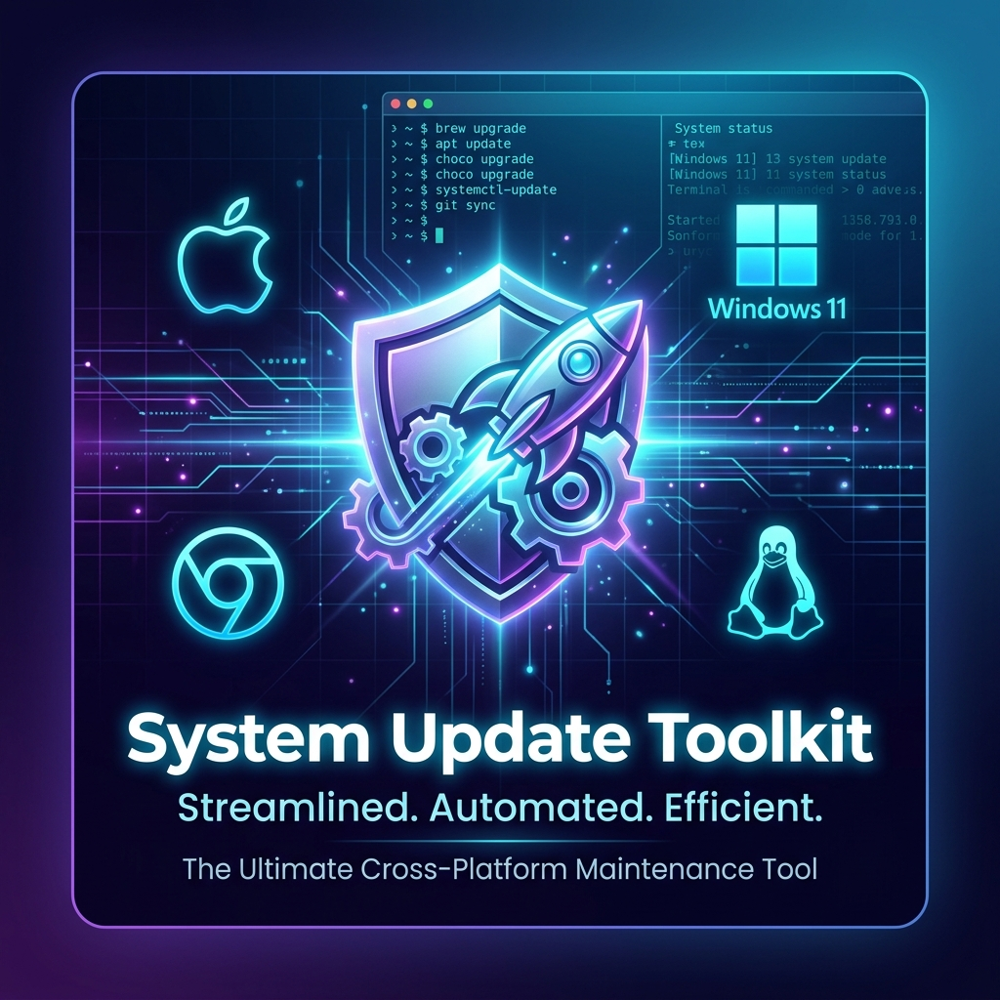
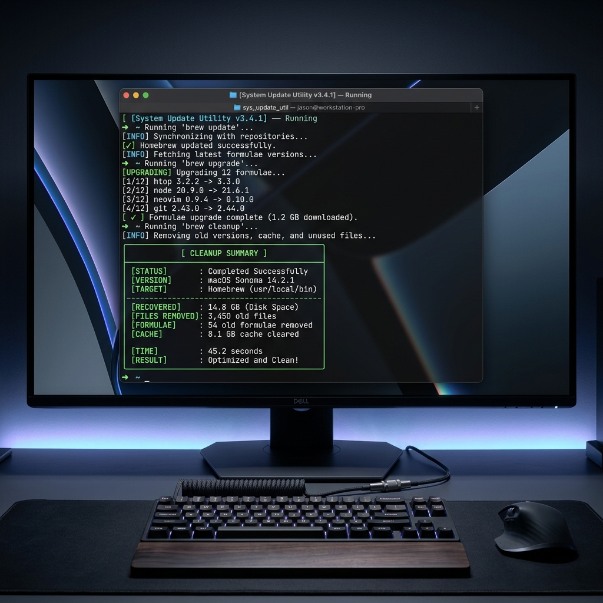

# 🚀 System Update Toolkit — Automated Cross-Platform System Update, Cache Cleanup & Disk Space Recovery

<div align="center">

[](LICENSE)
[](https://github.com/nilesh-gore/system-update-toolkit/releases)
[](https://www.shellcheck.net/)
[](https://github.com/nilesh-gore/system-update-toolkit/actions/workflows/shellcheck.yml)
[](https://github.com/nilesh-gore/system-update-toolkit/actions/workflows/powershell.yml)
[](https://securityscorecards.dev/viewer/?uri=github.com/nilesh-gore/system-update-toolkit)
[](#-supported-platforms)
<br>
[](https://github.com/nilesh-gore/system-update-toolkit)
[](https://github.com/nilesh-gore/system-update-toolkit)
[](https://github.com/nilesh-gore/system-update-toolkit/commits/main)
[](https://github.com/nilesh-gore/system-update-toolkit/graphs/commit-activity)
[](https://github.com/nilesh-gore/system-update-toolkit/issues)
[](https://github.com/nilesh-gore/system-update-toolkit/graphs/contributors)
[](https://github.com/nilesh-gore/system-update-toolkit/pulls)
<br>
[](https://github.com/nilesh-gore/system-update-toolkit/stargazers)
[](https://github.com/nilesh-gore/system-update-toolkit/network/members)

**Automate repetitive system updates and disk cleanup tasks with a single, unified command.**

One script automatically detects your operating system and runs the correct system maintenance routine—updating system packages, purging application cache, rotating logs, cleaning up temp files, and performing disk recovery—safely and interactively. Nothing runs without your authorization.

> *One script. Seven platforms. Gigabytes of disk space recovered.* 💾

**⚡ Try it in 10 seconds:**

```bash
curl -fsSL https://raw.githubusercontent.com/nilesh-gore/system-update-toolkit/main/install.sh | sh
```

*macOS (Homebrew) · Ubuntu/Debian (APT) · Fedora (DNF/DNF5) · Arch (pacman) · openSUSE (zypper) · ChromeOS (Debian Crostini) — see [Quick Start](#-quick-start) for Windows and the Git clone instructions.*



*The ultimate premium terminal maintenance suite for developers and power users*

</div>

---

## 📖 Table of Contents

- [About](#-about)
- [Supported Platforms](#-supported-platforms)
- [Features at a Glance](#-features-at-a-glance)
- [Quick Start](#-quick-start)
- [Detailed Script Breakdown](#-detailed-script-breakdown)
- [Comparison Matrix](#-comparison-matrix)
- [Requirements](#-requirements)
- [Screenshots & Terminal Output](#-screenshots--terminal-output)
- [Troubleshooting](#-troubleshooting)
- [Automation & Scheduling](#-automation--scheduling)
- [FAQ](#-frequently-asked-questions)
- [Testing & Verification](#-testing--verification)
- [Contributing](#-contributing)
- [Changelog](#-changelog)
- [License](#-license)

---

## 📌 About

**System Update Toolkit** is a collection of lightweight, interactive shell scripts designed to automate the tedious process of keeping your operating system, packages, and development tools up to date.

Whether you're a developer maintaining multiple machines, a sysadmin managing servers, or a power user who wants a clean system — this toolkit has you covered.

### 🎯 Key Benefits

| Benefit | Description |
| :--- | :--- |
| ⏱️ **Time Saver** | One command replaces 10+ manual steps |
| 🧹 **Disk Recovery** | Automatically cleans caches, old versions, and temp files |
| 🛡️ **Safe Dry Run** | Use `-d` to see what will happen before touching any data |
| 🔔 **Desktop Alerts** | Native OS notifications when maintenance is complete |
| 🗓️ **Auto-Schedule** | Use `--schedule` to set up weekly automated maintenance |
| 🎨 **Premium UI** | Beautiful ANSI color-coded output with progress indicators |
| 🔄 **Interactive** | Choose exactly what to clean — nothing runs without your consent |
| 📊 **Recovery Summary**| See exactly how much disk space was recovered |
| ⚠️ **Storage Warning**| Instant alert when free space drops below 10 GB to prevent system lag |

---

## 🖥️ Supported Platforms

<table>
<tr>
<td align="center"><b>🐧 Ubuntu / Debian</b><br>APT<br><code>debian_update_util.sh</code></td>
<td align="center"><b>🎩 Fedora / RHEL</b><br>DNF<br><code>fedora_update_util.sh</code></td>
<td align="center"><b>🍎 macOS</b><br>Homebrew<br><code>brew_update_util.sh</code></td>
<td align="center"><b>🪟 Windows</b><br>PowerShell + Winget<br><code>win_update_util.ps1</code></td>
<td align="center"><b>💻 ChromeOS</b><br>Crostini (Linux)<br><code>chromeos_update_util.sh</code></td>
</tr>
<tr>
<td align="center"><b>🏔️ Arch / Manjaro / EndeavourOS</b><br>pacman<br><code>arch_update_util.sh</code></td>
<td align="center"><b>🦎 openSUSE Leap / Tumbleweed</b><br>zypper<br><code>opensuse_update_util.sh</code></td>
<td colspan="3"></td>
</tr>
</table>

---

## ✨ Features at a Glance

### 🛡️ Safe by Default — all platforms
`-y`/`--yes` (or answering `a` at a prompt) only approves **routine** steps such as package upgrades and package-manager cache cleanup. Steps that delete data are **never** approved by `--yes` and are skipped in cron/CI unless you ask for them:

| Destructive step | Unix flag | Windows switch |
| :--- | :--- | :--- |
| Wipe user application caches (`~/.cache`) | `--clear-cache` (Linux) | — |
| Clear shell history | `--clear-history` | `-ClearHistory` |
| `docker system prune --volumes` | `--docker-cleanup` | `-DockerCleanup` |

In an interactive session you can also approve each one with an explicit `y` at its own prompt.

### 🐳 Docker Container Logs — all platforms
Docker's default `json-file` log driver never rotates logs, so long-running containers can silently fill the disk — and `docker system prune` does not touch them. Every script now:
- ✅ **Reports** container log sizes (Linux), the largest offenders, and how many containers have **no log size limit** (all platforms) — read-only, every run
- ✅ Warns when any container log exceeds 100M
- ✅ `--docker-logs-truncate[=SIZE]` empties oversized logs in place; containers keep running (Linux)
- ✅ `--docker-log-rotation` merges `max-size: 50m` / `max-file: 3` into `daemon.json` with a timestamped backup and `dockerd --validate`; Docker is never restarted automatically (Linux)
- ✅ Docker Desktop (macOS/Windows) and Colima keep logs inside a VM, so the scripts print the exact settings to apply instead
- ✅ Neither option is enabled by `--yes`

### 🍎 macOS — `brew_update_util.sh`
- ✅ Updates Homebrew definitions (`brew update`)
- ✅ Smart detection of outdated formulae and casks before upgrading
- ✅ Optional **Greedy Mode** for casks that auto-update (Chrome, Slack, VS Code, etc.)
- ✅ Removes unused dependencies (`brew autoremove`)
- ✅ Runs `brew cleanup` to purge old versions
- ✅ Optional cache purge (`~/Library/Caches/Homebrew`)
- ✅ Integrated `brew doctor` health check
- ✅ Detects running Homebrew background services and **autorestarts** updated ones
- ✅ Optional terminal history clearing (`--clear-history`; supports both Zsh and Bash)
- ✅ Real-time disk partition space tracking via `df` (total physical storage reclaimed)
- ✅ **Dry Run Support** (`-d`): Preview cleanup actions safely
- ✅ **Desktop Notifications**: Pings you when updates are done
- ✅ **Yes to All** mode: type `a` at any prompt, or use `-y`, to auto-approve routine prompts (destructive steps need their own flags)
- ✅ **Low Storage Alert**: Native terminal and desktop notification warnings if system free space drops below 10 GB

### 🐧 Ubuntu / Debian — `debian_update_util.sh`
- ✅ Full system update (`apt-get update` + `upgrade`, or `full-upgrade` with `--full-upgrade`)
- ✅ Fixes broken packages and installs missing dependencies
- ✅ Deep cleanup: APT cache, plus thumbnail and font caches with `--clear-cache`
- ✅ Systemd journal log rotation (keeps only last 7 days)
- ✅ Snap package refresh and old revision removal
- ✅ Package integrity verification via `debsums`
- ✅ System file consistency check (`apt-get check`)
- ✅ Logs all operations to `/var/log/sysupdate.log`
- ✅ Real-time disk partition space tracking via `df` (total physical storage reclaimed)
- ✅ Flag-driven (no prompts): `-y` confirms APT operations only; cleanup extras are opt-in flags
- ✅ Lock file prevents two runs at once; reports whether a reboot is required
- ✅ **Low Storage Alert**: Native warning and desktop notifications if system free space drops below 10 GB

### 🎩 Fedora / RHEL / CentOS — `fedora_update_util.sh`
- ✅ Next-gen **DNF5** package manager support with seamless `dnf` fallback
- ✅ Full system update (`dnf upgrade --refresh` / `dnf5 upgrade --refresh`)
- ✅ Removes unused dependencies (`dnf autoremove`)
- ✅ Deep cleanup: DNF cache (`dnf clean all`), plus app caches (`~/.cache`) with `--clear-cache`
- ✅ Systemd journal log rotation (keeps only last 7 days)
- ✅ Flatpak app updates and unused runtime removal
- ✅ Optional Snap package refresh and old revision removal
- ✅ Real-time disk partition space tracking via `df` (total physical storage reclaimed)
- ✅ **Yes to All** mode: type `a` at any prompt to auto-approve remaining routine prompts (destructive steps are still asked)
- ✅ **Low Storage Alert**: Native warning and desktop notifications if system free space drops below 10 GB

### 🪟 Windows — `win_update_util.ps1`
- ✅ Integrated execution from the **Shell wrapper** (`toolkit.sh`) in MSYS/Git Bash
- ✅ Lists and upgrades all apps via **Winget** (Windows Package Manager)
- ✅ Optional `--include-unknown` flag for comprehensive upgrades
- ✅ WSL kernel update (`wsl --update`)
- ✅ Native Disk Cleanup tool integration (`cleanmgr`)
- ✅ Purges system and user `%TEMP%` directories
- ✅ Optional PSReadLine history clearing (`-ClearHistory`) with **robust locking protection**
- ✅ Native **.NET Toast Notifications** (`System.Windows.Forms.NotifyIcon`) on all Windows editions
- ✅ Admin privilege detection with warnings
- ✅ Windows Store app reminder
- ✅ **Yes to All** mode: type `a` at any prompt to auto-approve remaining routine prompts (destructive steps are still asked)
- ✅ **Low Storage Alert**: Native alert banner and toast notification warnings if system partition free space drops below 10 GB

### 💻 ChromeOS — `chromeos_update_util.sh`
- ✅ Full Debian container update (`apt-get update` + `full-upgrade`)
- ✅ Flatpak app updates and unused runtime removal
- ✅ APT cache cleanup (`autoremove` + `autoclean`)
- ✅ Optional global NPM package updates
- ✅ Optional Python pip upgrade and outdated package listing
- ✅ Optional terminal history clearing (`--clear-history`)
- ✅ Real-time disk partition space tracking via `df`
- ✅ **Yes to All** mode: type `a` at any prompt to auto-approve remaining routine prompts (destructive steps are still asked)
- ✅ **Low Storage Alert**: Native warnings and desktop notifications if system container free space drops below 10 GB

### 🏔️ Arch / Manjaro / EndeavourOS — `arch_update_util.sh`
- ✅ Full system update (`pacman -Syu`)
- ✅ Removes orphaned packages (`pacman -Rns $(pacman -Qtdq)`)
- ✅ Package cache cleanup (`paccache -rk1`, falling back to `pacman -Sc`)
- ✅ Systemd journal log rotation (keeps only last 7 days)
- ✅ Flatpak and Snap updates with unused runtime / old revision removal
- ✅ Real-time disk partition space tracking via `df`
- ✅ **Yes to All** mode: type `a` at any prompt to auto-approve remaining routine prompts (destructive steps are still asked)
- ✅ **Low Storage Alert**: Native warning and desktop notifications if system free space drops below 10 GB

### 🦎 openSUSE Leap / Tumbleweed — `opensuse_update_util.sh`
- ✅ Repository refresh and full update (`zypper refresh` + `zypper update`)
- ✅ Removes unneeded packages (`zypper packages --unneeded`)
- ✅ Package cache cleanup (`zypper clean --all`)
- ✅ Systemd journal log rotation (keeps only last 7 days)
- ✅ Flatpak and Snap updates with unused runtime / old revision removal
- ✅ Real-time disk partition space tracking via `df`
- ✅ **Yes to All** mode: type `a` at any prompt to auto-approve remaining routine prompts (destructive steps are still asked)
- ✅ **Low Storage Alert**: Native warning and desktop notifications if system free space drops below 10 GB

---

## 🚀 Quick Start

### Option A: Installer Script (fastest)

Downloads the toolkit to `~/.system-update-toolkit` and offers to run it immediately — nothing else to set up.

```bash
curl -fsSL https://raw.githubusercontent.com/nilesh-gore/system-update-toolkit/main/install.sh | sh
```

### Option B: Clone the Repository (if you'd rather inspect the code first)

```bash
git clone https://github.com/nilesh-gore/system-update-toolkit.git && cd system-update-toolkit && chmod +x toolkit.sh && ./toolkit.sh
```

Or step by step:

```bash
git clone https://github.com/nilesh-gore/system-update-toolkit.git
cd system-update-toolkit
chmod +x toolkit.sh
./toolkit.sh
```

Either way, `toolkit.sh` automatically detects your OS and runs the correct maintenance script.

<details>
<summary><b>Manual Execution (Per OS)</b></summary>
If you prefer to run a specific script directly:

* **🍎 macOS:** `./brew_update_util.sh`
* **🐧 Ubuntu/Debian:** `sudo ./debian_update_util.sh`
* **🎩 Fedora/RHEL:** `./fedora_update_util.sh` (calls `sudo` for each step)
* **🏔️ Arch/Manjaro:** `./arch_update_util.sh` (calls `sudo` for each step)
* **🦎 openSUSE:** `./opensuse_update_util.sh` (calls `sudo` for each step)
* **💻 ChromeOS:** `./chromeos_update_util.sh`
* **🪟 Windows:** `powershell -File .\win_update_util.ps1`
</details>

---

## 🔍 Detailed Script Breakdown

### Universal Wrapper: `toolkit.sh`
The primary entry point for all systems. It automatically detects the host OS and delegates to the correct script.
```bash
./toolkit.sh [OPTIONS]

Options:
  -h, --help        Show help message
  -v, --version     Show version info
  -y, --yes         Automatic yes to routine prompts (never to destructive ones)
  -d, --dry-run     Preview what will happen without changes
  --notify          Send desktop notification on completion
  --schedule        Set up weekly automated maintenance (Linux/macOS)
  --unschedule      Remove the weekly maintenance job

Destructive actions (never enabled by --yes):
  --clear-cache     Clear user application caches (Linux)
  --clear-history   Clear shell history files
  --docker-cleanup  Run 'docker system prune --volumes'

Docker log options (Linux; report-only guidance on macOS/Windows):
  --docker-logs-truncate[=SIZE]  Empty container logs larger than SIZE (default 100M)
  --docker-log-rotation          Configure log rotation (max-size 50m, max-file 3)
```
On Windows, `toolkit.sh` translates `--yes`, `--dry-run`, `--notify`, `--clear-history` and `--docker-cleanup` into the PowerShell switches.

### macOS: `brew_update_util.sh`
```
Step 1  →  Update Homebrew definitions
Step 2  →  Detect outdated formulae & casks
Step 3  →  Upgrade formulae (if any outdated)
Step 4  →  Upgrade casks (with optional Greedy Mode)
Step 5  →  Remove unused dependencies (autoremove)
Step 6  →  Cleanup old versions (brew cleanup -s)
Step 7  →  Optional: Purge Homebrew cache
Step 8  →  Check running services
Step 9  →  Optional: Run brew doctor
Step 10 →  Optional: Docker cleanup (--docker-cleanup)
Step 11 →  Docker container logs: unlimited-container report & Docker Desktop guidance
Step 12 →  Display cleanup summary
Step 13 →  Optional: Clear terminal history (--clear-history)
```

### Ubuntu / Debian: `debian_update_util.sh`
```
Step 1  →  Capture disk usage (before)
Step 2  →  Update package lists
Step 3  →  Full system upgrade
Step 4  →  Fix broken packages & missing deps
Step 5  →  Remove unused packages (autoremove --purge)
Step 6  →  Clean APT cache (thumbnail/font caches with --clear-cache)
Step 7  →  Vacuum journal logs (7-day retention)
Step 8  →  List held packages, apt-get check, debsums integrity check
Step 9  →  Refresh Snap packages & remove old revisions
Step 10 →  Optional: Docker cleanup (--docker-cleanup)
Step 11 →  Report Docker container log sizes & rotation status
           Optional: truncate large logs (--docker-logs-truncate[=SIZE])
           Optional: configure log rotation (--docker-log-rotation)
Step 12 →  Optional: Clear terminal history (--clear-history)
Step 13 →  Capture disk usage (after) & display summary (incl. reboot required)
Step 14 →  Log to /var/log/sysupdate.log
```

### Fedora / RHEL: `fedora_update_util.sh`
```
Step 1  →  Capture disk usage (before)
Step 2  →  Refresh DNF metadata & upgrade packages
Step 3  →  Remove unused packages (autoremove)
Step 4  →  Clean DNF cache (clean all)
Step 5  →  Optional: Clear app caches & thumbnails (--clear-cache)
Step 6  →  Vacuum journal logs (7-day retention)
Step 7  →  Update Flatpak apps & remove unused runtimes
Step 8  →  Refresh Snap packages & remove old revisions (if installed)
Step 9  →  Optional: Docker cleanup (--docker-cleanup)
Step 10 →  Docker container logs (report, --docker-logs-truncate, --docker-log-rotation)
Step 11 →  Capture disk usage (after) & display summary
Step 12 →  Optional: Clear terminal history (--clear-history)
Step 13 →  Log to /var/log/sysupdate.log
```

### Arch / Manjaro / EndeavourOS: `arch_update_util.sh`
```
Step 1  →  Capture disk usage (before)
Step 2  →  Sync repositories & upgrade (pacman -Syu)
Step 3  →  Remove orphaned packages
Step 4  →  Clean pacman cache (paccache -rk1 or pacman -Sc)
Step 5  →  Optional: Clear app caches & thumbnails (--clear-cache)
Step 6  →  Vacuum journal logs (7-day retention)
Step 7  →  Update Flatpak / Snap & remove unused runtimes and old revisions
Step 8  →  Optional: Docker cleanup (--docker-cleanup)
Step 9  →  Docker container logs (report, --docker-logs-truncate, --docker-log-rotation)
Step 10 →  Capture disk usage (after) & display summary
Step 11 →  Optional: Clear terminal history (--clear-history)
Step 12 →  Log to /var/log/sysupdate.log
```

### openSUSE Leap / Tumbleweed: `opensuse_update_util.sh`
```
Step 1  →  Capture disk usage (before)
Step 2  →  Refresh repositories & update (zypper refresh + update)
Step 3  →  Remove unneeded packages
Step 4  →  Clean zypper cache (clean --all)
Step 5  →  Optional: Clear app caches & thumbnails (--clear-cache)
Step 6  →  Vacuum journal logs (7-day retention)
Step 7  →  Update Flatpak / Snap & remove unused runtimes and old revisions
Step 8  →  Optional: Docker cleanup (--docker-cleanup)
Step 9  →  Docker container logs (report, --docker-logs-truncate, --docker-log-rotation)
Step 10 →  Capture disk usage (after) & display summary
Step 11 →  Optional: Clear terminal history (--clear-history)
Step 12 →  Log to /var/log/sysupdate.log
```

### Windows: `win_update_util.ps1`
```
Step 1  →  Check for Administrator privileges & low storage
Step 2  →  List outdated Winget packages
Step 3  →  Optional: Upgrade all Winget packages
Step 4  →  Windows Store reminder & WSL kernel update
Step 5  →  Launch Disk Cleanup (cleanmgr)
Step 6  →  Optional: Clear temp directories
Step 7  →  Optional: Clear PowerShell history (-ClearHistory)
Step 8  →  Optional: Docker cleanup (-DockerCleanup)
Step 9  →  Docker container logs: unlimited-container report & Docker Desktop guidance
Step 10 →  Display cleanup summary
```

### ChromeOS: `chromeos_update_util.sh`
```
Step 1  →  Update Debian package definitions
Step 2  →  Full system upgrade
Step 3  →  Update Flatpak apps & remove unused runtimes
Step 4  →  Clean APT cache (autoremove + autoclean)
Step 5  →  Optional: Clear app caches & thumbnails (--clear-cache)
Step 6  →  Optional: Update global NPM packages
Step 7  →  Optional: Update pip & list outdated packages
Step 8  →  System file consistency check (apt-get check)
Step 9  →  Optional: Docker cleanup (--docker-cleanup)
Step 10 →  Docker container logs (report, --docker-logs-truncate, --docker-log-rotation)
Step 11 →  Display cleanup summary
Step 12 →  Optional: Clear terminal history (--clear-history)
Step 13 →  Log to /var/log/sysupdate.log
```

---

## 📊 Comparison Matrix

| Feature | 🐧 Debian/Ubuntu | 🎩 Fedora/RHEL | 🏔️ Arch | 🦎 openSUSE | 🍎 macOS | 🪟 Windows | 💻 ChromeOS |
| :--- | :---: | :---: | :---: | :---: | :---: | :---: | :---: |
| **Package Manager** | `apt` | `dnf` | `pacman` | `zypper` | `brew` | `winget` | `apt` |
| **GUI App Updates** | `snap` | `flatpak` | `flatpak` / `snap` | `flatpak` / `snap` | `cask` | `winget` | `flatpak` |
| **System Upgrade** | ✅ | ✅ | ✅ | ✅ | ✅ | ✅ | ✅ |
| **Cache Cleanup** | ✅ | ✅ | ✅ | ✅ | ✅ | ✅ | ✅ |
| **Disk Space Recovery** | ✅ | ✅ | ✅ | ✅ | ✅ | ✅ | ✅ |
| **Health Check** | `debsums` | — | — | — | `brew doctor` | — | `apt-get check` |
| **Log Vacuuming** | ✅ (journald) | ✅ (journald) | ✅ (journald) | ✅ (journald) | — | — | — |
| **Service Monitor** | — | — | — | — | ✅ | — | — |
| **Dev Tool Updates** | — | — | — | — | — | — | `npm` / `pip` |
| **History Clearing (opt-in)** | ✅ | ✅ | ✅ | ✅ | ✅ | ✅ | ✅ |
| **Docker Cleanup (opt-in)** | ✅ | ✅ | ✅ | ✅ | ✅ | ✅ | ✅ |
| **Docker Log Report** | ✅ sizes | ✅ sizes | ✅ sizes | ✅ sizes | limits only | limits only | ✅ sizes |
| **Docker Log Truncate / Rotation** | ✅ | ✅ | ✅ | ✅ | guidance | guidance | ✅ |
| **Color-coded Output** | ✅ | ✅ | ✅ | ✅ | ✅ | ✅ | ✅ |
| **Interactive Prompts** | — (flags) | ✅ | ✅ | ✅ | ✅ | ✅ | ✅ |
| **POSIX Compatible** | ✅ | ✅ | ✅ | ✅ | ✅ | — | ✅ |
| **Yes to All (`-y`, routine only)** | ✅ | ✅ | ✅ | ✅ | ✅ | ✅ | ✅ |
| **Dry Run (`-d`)** | ✅ | ✅ | ✅ | ✅ | ✅ | ✅ | ✅ |
| **Desktop Notifications** | ✅ | ✅ | ✅ | ✅ | ✅ | ✅ | ✅ |
| **Auto-Scheduling (`--schedule`)** | ✅ (root cron) | ✅ (root cron) | ✅ (root cron) | ✅ (root cron) | ✅ (user cron) | ❌ (Task Scheduler) | ✅ (root cron) |
| **Logging** | ✅ | ✅ | ✅ | ✅ | — | — | ✅ |
| **Low Storage Alerts**| ✅ (10 GB) | ✅ (10 GB) | ✅ (10 GB) | ✅ (10 GB) | ✅ (10 GB) | ✅ (10 GB) | ✅ (10 GB) |

---

## 🛠 Requirements

| Platform | Required | Optional |
| :--- | :--- | :--- |
| **Ubuntu/Debian** | Ubuntu/Debian 18.04+, `sudo`, `apt`, `journalctl` | `snap`, `debsums`, `numfmt` (coreutils) |
| **Fedora/RHEL** | Fedora 30+, `sudo`, `dnf`, `journalctl` | `flatpak`, `snap`, `numfmt` |
| **Arch/Manjaro** | `sudo`, `pacman`, `journalctl` | `paccache` (pacman-contrib), `flatpak`, `snap` |
| **openSUSE** | Leap 15+ / Tumbleweed, `sudo`, `zypper`, `journalctl` | `flatpak`, `snap` |
| **Docker log features** | `docker` CLI | `python3` or `jq` (to edit `daemon.json`), `dockerd` 23+ (config validation) |
| **macOS** | macOS 12+, [Homebrew](https://brew.sh) | — |
| **Windows** | Windows 10/11, PowerShell 5.1+, [Winget](https://github.com/microsoft/winget-cli) | Administrator privileges for full cleanup |
| **ChromeOS** | Linux (Crostini) enabled in Settings | `flatpak`, `npm`, `pip3` |

---

## 📸 Screenshots & Terminal Output

<div align="center">
  
</div>


---

## ⚙️ Troubleshooting

<details>
<summary><b>🪟 Windows: Script execution is disabled</b></summary>

```powershell
Set-ExecutionPolicy -ExecutionPolicy RemoteSigned -Scope CurrentUser
```
This allows locally-created scripts to run while still blocking unsigned remote scripts.
</details>

<details>
<summary><b>🍎 macOS: Homebrew not found</b></summary>

Install Homebrew first:
```bash
/bin/bash -c "$(curl -fsSL https://raw.githubusercontent.com/Homebrew/install/HEAD/install.sh)"
```
Then add it to your PATH as instructed by the installer.
</details>

<details>
<summary><b>🐧 Linux: Permission denied</b></summary>

Always run the Linux script with `sudo`:
```bash
sudo ./debian_update_util.sh
```
</details>

<details>
<summary><b>💻 ChromeOS: Linux terminal not available</b></summary>

Go to **Settings → Advanced → Developers → Linux development environment** and turn it on. ChromeOS will set up a Debian container automatically.
</details>

<details>
<summary><b>🐧 Linux: debsums not installed</b></summary>

```bash
sudo apt install debsums
```
This enables package integrity verification. The script will skip this step if not installed.
</details>

---

<details>
<summary><b>📦 Package manager lock file detected</b></summary>

Another package manager process (such as Software Updater, GNOME Software, or another terminal session) may already be running, preventing updates.

**Ubuntu/Debian**
```bash
sudo lsof /var/lib/dpkg/lock-frontend
sudo lsof /var/lib/apt/lists/lock
```

**Fedora/RHEL**
```bash
sudo lsof /var/cache/dnf
```

Wait for the active process to finish before running the toolkit again. Avoid deleting lock files manually, as doing so may leave the package database in an inconsistent state.

</details>

## ⏰ Automation & Scheduling

### ✅ Recommended: built-in scheduler (Linux & macOS)
```bash
./toolkit.sh --schedule     # weekly, Mondays at midnight
./toolkit.sh --unschedule   # remove it again
```
- **Linux:** the job is added to **root's crontab** (you'll be asked for your `sudo` password once), because the update scripts need root and `sudo` cannot prompt inside cron. Output goes to `/var/log/sysupdate-cron.log`.
- **macOS:** the job is added to **your** crontab, because Homebrew refuses to run as root. Output goes to `~/Library/Logs/system-update-toolkit.log`.
- The job runs with `-y`, so destructive steps (cache wipe, history, Docker cleanup) are **skipped**. Re-running `--schedule` replaces the job instead of duplicating it, and other cron entries are never touched.

### 🐧 Linux — manual cron
```bash
sudo crontab -e

# Run every Sunday at 3 AM (root's crontab; set PATH because cron's default is minimal)
0 3 * * 0 PATH=/usr/local/sbin:/usr/local/bin:/usr/sbin:/usr/bin:/sbin:/bin /path/to/toolkit.sh -y >> /var/log/sysupdate-cron.log 2>&1
```

### 🍎 macOS — manual cron
```bash
crontab -e
0 3 * * 0 PATH=/opt/homebrew/bin:/usr/local/bin:/usr/bin:/bin /path/to/brew_update_util.sh -y >> ~/Library/Logs/system-update-toolkit.log 2>&1
```

### 🪟 Windows — Task Scheduler
```powershell
# Open Task Scheduler → Create Basic Task
# Trigger: Weekly
# Action: Start a Program
# Program: powershell.exe
# Arguments: -NoProfile -ExecutionPolicy Bypass -File "C:\path\to\win_update_util.ps1" -Yes
# Tick "Run with highest privileges" for system-level temp cleanup
```

---

## ❓ Frequently Asked Questions

<details>
<summary><b>Will this script delete my personal files?</b></summary>

**No.** The scripts only clean system-managed caches, temporary files, old package versions, and system log files. Your documents, projects, and personal data are completely untouched. The few steps that delete user data (`~/.cache`, shell history, unused Docker volumes) are opt-in and never enabled by `--yes`.
</details>

<details>
<summary><b>How to run system updates and clean cache with a single script?</b></summary>

Simply run `./toolkit.sh`. The toolkit automatically detects your host operating system (macOS, Ubuntu, Fedora, ChromeOS, or Windows) and runs the appropriate tailored script (`brew_update_util.sh`, `debian_update_util.sh`, etc.) to perform all updates and cleanups in one go.
</details>

<details>
<summary><b>Can I run this on a headless server or in non-interactive CI mode?</b></summary>

**Yes.** Every script can run non-interactively. Use `-y`/`--yes` to approve routine prompts (package upgrades, package-manager cache cleanup, health checks):
```bash
sudo ./toolkit.sh --yes
```
`--yes` never approves destructive steps. Wiping `~/.cache`, clearing shell history and `docker system prune --volumes` are skipped unless you pass their flags explicitly:
```bash
sudo ./toolkit.sh --yes --clear-cache --clear-history --docker-cleanup
```
On Windows the equivalents are `-ClearHistory` and `-DockerCleanup` (`toolkit.sh` translates the Unix-style options for you). When there is no terminal (cron, CI), destructive steps are skipped unless their flag is given.
</details>

<details>
<summary><b>How do I safely clear package cache and logs on Ubuntu/Debian?</b></summary>

The `debian_update_util.sh` script does this automatically. It cleans the APT cache (`apt-get clean`), clears the thumbnail cache, clears old log revisions, and vacuums systemd journal logs keeping only the last 7 days of logs.
</details>

<details>
<summary><b>How do I clear terminal shell history in macOS or Linux?</b></summary>

Pass `--clear-history` (`-ClearHistory` on Windows), or answer `y` when an interactive run asks at the end. It empties the Bash/Zsh history files on macOS/Linux/ChromeOS and the PSReadLine history file on Windows. History already loaded in an open terminal stays in that session's memory until you close it (run `history -c` or `Clear-History` to drop it). `--yes` never clears history.
</details>

<details>
<summary><b>How much disk space can I expect to recover?</b></summary>

It varies by system. Typical results:
- **macOS**: 200MB – 2GB (old Homebrew versions and cache)
- **Linux**: 500MB – 5GB (APT cache, journal logs, old Snaps)
- **Windows**: 1GB – 10GB (temp files, Disk Cleanup)
</details>

<details>
<summary><b>How can I automate these system maintenance scripts?</b></summary>

Run `./toolkit.sh --schedule` for a weekly job (root's crontab on Linux, your crontab on macOS) and `./toolkit.sh --unschedule` to remove it. On Windows, use Task Scheduler. Scheduled runs use `-y`, so destructive steps are skipped. See [Automation & Scheduling](#-automation--scheduling).
</details>

<details>
<summary><b>Does it support Arch Linux or other package managers?</b></summary>

**Debian/Ubuntu** (`apt`), **Fedora/RHEL** (`dnf`/`dnf5`), **macOS** (`brew`), **Arch/Manjaro/EndeavourOS** (`pacman`), and **openSUSE Leap/Tumbleweed** (`zypper`) are all officially supported. Contributions are welcome!
</details>

<details>
<summary><b>Is it safe to run this toolkit regularly?</b></summary>

**Yes.** The toolkit is designed to be safely run as part of your regular maintenance routine. It only updates packages using the operating system's official package manager and removes temporary files, caches, old package versions, and logs that are safe to clean. It never modifies your personal files or project data.
</details>
<details>
  
<summary><b>Does the toolkit support a preview mode before making changes?</b></summary>

**Yes.** The toolkit includes a built-in **Dry Run** mode using the `-d` or `--dry-run` flag. In this mode, it analyzes your system and shows which packages would be updated and which cleanup actions would be performed—without actually modifying anything. This is ideal if you want to review the maintenance plan before running it.

```bash
./toolkit.sh --dry-run
```

Dry Run mode helps you verify operations safely, making it suitable for production systems, servers, and cautious first-time users.
</details>

<details>
<summary><b>Can I use this toolkit on production servers?</b></summary>

**Yes.** The toolkit is designed to be safe for production environments when used responsibly. It relies on your operating system's official package manager (APT, DNF, pacman, zypper, Homebrew, or Winget) and only performs standard maintenance tasks such as installing updates, removing obsolete packages, cleaning caches, rotating logs, and reclaiming disk space. For extra confidence, you can first preview all planned actions using the built-in **Dry Run** mode:

```bash
./toolkit.sh --dry-run
```

Review the output, then rerun the toolkit without `--dry-run` when you're ready to perform the maintenance.

</details>

<details>
<summary><b>Will this toolkit automatically reboot my computer after installing updates?</b></summary>

**No.** The toolkit never forces an automatic restart or shutdown. If your operating system or package manager indicates that a reboot is recommended (for example, after a kernel or system component update), you'll see the normal system notification or package manager message. You remain in full control of when—or whether—to restart your device.

This makes the toolkit safe to use on workstations, development machines, and servers where unexpected reboots could interrupt active workloads.
</details>

<details>
<summary><b>Does this toolkit clean Docker images, containers, or volumes?</b></summary>

**Yes.** If the `docker` CLI is detected on your system, the toolkit can optionally reclaim space via `docker system prune --volumes`, removing:
- Dangling images
- Stopped containers
- Unused networks
- Unused volumes
- Build cache

Because it deletes unused volumes, this step never runs automatically and is **not** approved by `-y`/`--yes` or by answering `a` (all). Either pass `--docker-cleanup` (`-DockerCleanup` on Windows), or answer `y` at its own prompt in an interactive session. If Docker isn't installed, this step is skipped automatically and the rest of the toolkit runs normally.

</details>

## 🧪 Testing & Verification

We use automated unit tests and static code analysis to guarantee script quality and reliability.

### Unix Shell Scripts
All Unix shell scripts, including the shared `lib/docker_logs.sh`, are linted with `shellcheck`, and CI runs `./toolkit.sh --dry-run --yes --notify` on every pull request:
```bash
shellcheck -x *.sh lib/*.sh
```

### Windows PowerShell Script
The Windows-specific script (`win_update_util.ps1`) is unit tested using **Pester** (the official testing framework for PowerShell).

Pester mock objects are used so that the tests can run **safely on any platform (including macOS/Linux)** inside GitHub Actions CI, without actually making changes, deleting files, or launching Windows apps.

To run the unit tests locally on Windows or macOS/Linux (with PowerShell Core installed):
```powershell
Invoke-Pester -Path .\tests\win_update_util.Tests.ps1 -Output Detailed
```

---

## 🤝 Contributing

Contributions are what make the open-source community such an amazing place to learn, inspire, and create. Any contributions you make are **greatly appreciated**.

1. **Fork** the Project
2. **Create** your Feature Branch (`git checkout -b feature/AmazingFeature`)
3. **Commit** your Changes (`git commit -m 'feat: add AmazingFeature'`)
4. **Push** to the Branch (`git push origin feature/AmazingFeature`)
5. **Open** a Pull Request

### 💡 Ideas for Contributions
- Add Chocolatey support for Windows alongside Winget
- Implement a "Doctor" health check for Windows/Linux/Fedora

---

## 📝 Changelog

| Version | Date | Changes |
| :--- | :--- | :--- |
| **v3.2.1** | 2026-11-23 | **Snap Docker fix**: `--docker-log-rotation` now detects the Snap Docker daemon from the running daemon (its data root) instead of the `docker` CLI path. On hosts where `/usr/bin/docker` talks to the Snap daemon (or both are installed), it previously wrote `/etc/docker/daemon.json` and suggested `systemctl restart docker`, so the setting never took effect; it now writes `/var/snap/docker/current/config/daemon.json` and suggests `sudo snap restart docker`. |
| **v3.2.0** | 2026-11-20 | **Docker Log Management, Safer `--yes` & Seven Platforms**: **New platforms**: Arch/Manjaro/EndeavourOS (`arch_update_util.sh`, pacman) and openSUSE Leap/Tumbleweed (`opensuse_update_util.sh`, zypper), both auto-detected by `toolkit.sh`. **Docker**: optional `docker system prune --volumes` cleanup on every platform; new shared `lib/docker_logs.sh` reports container log sizes, the largest containers and how many containers have no log size limit, warns when a log exceeds 100M, and adds `--docker-logs-truncate[=SIZE]` and `--docker-log-rotation` (merges `max-size: 50m`, `max-file: 3` into `daemon.json` with a backup and `dockerd --validate`; never restarts Docker) on Linux, with settings guidance for Docker Desktop/Colima on macOS and Windows. **Safety**: `-y`/`--yes` (and answering `a`) now only approve routine prompts; wiping `~/.cache`, clearing shell history and Docker cleanup need `--clear-cache`, `--clear-history`, `--docker-cleanup` (`-ClearHistory`, `-DockerCleanup` on Windows) or an explicit `y`, and are skipped without a terminal. **Scheduling**: `--schedule` now installs the job in root's crontab on Linux (it previously failed from the user crontab), sets a full `PATH`, logs to `/var/log/sysupdate-cron.log`, only touches its own entry; new `--unschedule`. **Ubuntu/Debian v3**: lock file, reboot-required detection, warning counter, `--full-upgrade`, `--no-color`, non-root dry-run. **Breaking**: `update_util.sh` renamed to `debian_update_util.sh` (`toolkit.sh` users unaffected). **Other**: `toolkit.sh` translates options for the Windows script; all scripts report 3.2.0; CI action updates; README and docs site cover all seven platforms. |
| **v2.7.0** | 2026-08-05 | **Per-Package Progress & Cross-Platform Hardening Release**: Enhanced macOS Homebrew update utility with per-package progress tracking (`[X/Y]`) and individual error handling for formulae and casks; hardened PowerShell scripts for cross-platform CI safety and PSScriptAnalyzer compliance; expanded documentation with Docker cleanup, safety guidelines, and reboot behavior details; updated CI action dependencies. |
| **v2.6.1** | 2026-07-20 | **Reliability & Compatibility Patch**: Fixed the `curl \| sh` installer's confirmation prompt, which could silently consume the script's own remaining lines instead of reading user input in piped/non-interactive contexts. Fixed Windows color output, which previously only rendered correctly on PowerShell 6+ despite PowerShell 5.1 being the documented minimum. Hardened the Debian and ChromeOS cleanup scripts so a single failed cache clear, snap removal, or `apt-get check` no longer aborts the run before the summary is shown. |
| **v2.6** | 2026-05-21 | **Proactive Storage Warning & Testing Release**: Added proactive low disk space checks (10 GB threshold) with native terminal alerts and desktop notifications across all five supported operating systems (macOS, Ubuntu, Fedora, ChromeOS, Windows) to prevent system slowdowns. Relocated and engineered a fully mocked, platform-agnostic Pester test suite in a dedicated `tests/` folder for seamless local testing on macOS/Linux and standard GitHub Actions CI integration. |
| **v2.5** | 2026-05-20 | **Premium & Robustness Update**: Dynamic DNF5 support for Fedora 41+, premium Windows native .NET toast notifications, active Windows execution in standard wrapper `toolkit.sh` via Git Bash, secure scheduling using POSIX-compliant `mktemp`, robust PowerShell history wiping (`Clear-Content`), and real-time physical partition space tracking via `df` |
| **v2.4** | 2026-05-13 | **Trust & Automation Update**: Added `-d`/`--dry-run` mode, native desktop notifications, and `--schedule` for automated weekly maintenance |
| **v2.3** | 2026-05-11 | **Major UX Overhaul**: Added `-y`/`--yes` CLI flags, modernized interactive prompts with `[y/n/a]` options, and added `toolkit.sh` unified wrapper |
| **v2.2** | 2026-05-08 | Added GitHub Actions CI (ShellCheck & PSScriptAnalyzer), concurrency rules, universal curl installer, docs website, and fixed all linting warnings |
| **v2.1** | 2026-05-08 | Added `a` (yes to all) interactive option across all prompts, `--help`/`--version` flags, made Linux cache wipes interactive, added disk stats & `apt-get check` to ChromeOS, added cleanup summary to Windows, fixed README inaccuracies, added LICENSE file |
| **v2.0** | 2026-05-07 | Added Windows & ChromeOS support, premium ANSI visuals, `brew doctor`, `autoremove`, greedy cask upgrades, comparison matrix |
| **v1.0** | Initial | Linux (`apt`) and macOS (`brew`) update utilities |

---

## ⭐ Star History

If this project saved you time or disk space, **please give it a ⭐!**
It costs nothing but helps others discover this toolkit. Every star counts! 🙏

[](https://github.com/nilesh-gore/system-update-toolkit)

---

## 📄 License

Distributed under the **MIT License**. See [`LICENSE`](LICENSE) for more information.

---

## 🔍 Keywords

`system-update` `system-maintenance` `cleanup-script` `disk-cleanup` `cache-cleaner` `homebrew-update` `apt-update` `winget-update` `shell-script` `powershell-script` `linux-maintenance` `macos-maintenance` `windows-maintenance` `chromeos` `devops-tools` `automation` `sysadmin` `terminal-utility` `package-manager` `disk-space-recovery`

---

<div align="center">

**Made with ❤️ by [Nilesh Gore](https://github.com/nilesh-gore)**

*Keep your systems clean. Keep your terminal beautiful.*

⭐ **Found this useful? Star the repo and share it!** ⭐

[⬆ Back to Top](#-system-update-toolkit--automated-cross-platform-system-update-cache-cleanup--disk-space-recovery)

</div>
